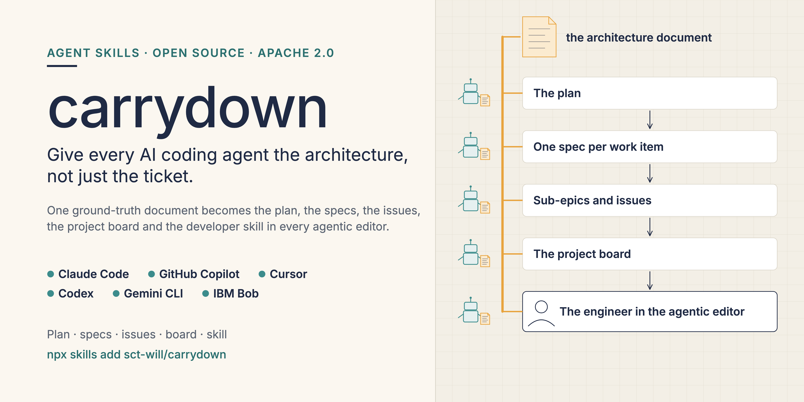
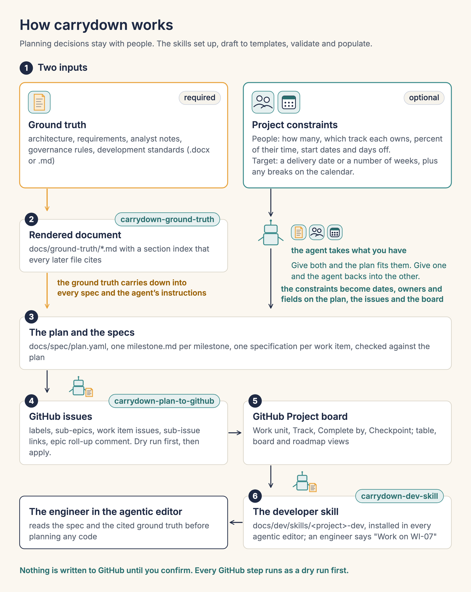

# carrydown

Turn your architecture document into a plan your team and its AI coding agents can follow: dated milestones, one spec per task tied to the paragraph it came from, GitHub issues, a filled project board, and a skill that makes each engineer's agent read the spec first.

[](LICENSE) [](https://github.com/sct-will/carrydown/commits/main) [](https://github.com/sct-will/carrydown/issues) [](https://github.com/sct-will/carrydown/actions/workflows/ci.yml) [](LICENSE-CONTENT.md) [](https://agentskills.io) [](#prerequisites) [](https://codespaces.new/sct-will/carrydown)

Install: `npx skills add sct-will/carrydown`

See the fictional sample first, no install: the [public board](https://github.com/users/sct-will/projects/2) and [one issue](https://github.com/sct-will/carrydown-sample/issues/9). Three clicks: open the board, open WI-03, then follow its specification link to the cited sections. The company, people and dates in the sample are fictional. The plan, specifications, issues and board are what the skills produced.

[See it in 60 seconds](#see-it-in-60-seconds) · [How it works](#how-it-works) · [Getting started](#getting-started) · [Prerequisites](#prerequisites) · [What you get](#what-you-get) · [Install options](#install-options) · [Sample](#sample) · [FAQ](#faq) · [Contributing](#contributing) · [Licence](#licence)

More: [Start here](START-HERE.md) · [Plan owner guide](docs/plan-owner-guide.md) · [Method](docs/method.md) · [Inputs](docs/inputs.md) · [Derive the date](docs/derive-the-date.md) · [A recorded run](docs/sample-run.md) · [Security](docs/security.md) · [Changelog](CHANGELOG.md) · [For agents](AGENTS.md)

## See it in 60 seconds

No agent, no token and no install. Clone the main repository and the sample repository side by side, then run three read-only commands on the sample. They print the schedule, the load table and the critical path, then the issues and the board the plan would create, without calling GitHub.

```bash
git clone https://github.com/sct-will/carrydown.git
git clone https://github.com/sct-will/carrydown-sample.git
cd carrydown
python3 scripts/check_specs.py --root ../carrydown-sample --report
python3 scripts/github_sync.py --root ../carrydown-sample --offline
python3 scripts/github_project.py --root ../carrydown-sample --offline
```

Measured on a laptop: the two clones took about 2 seconds, and each command about a fifth of a second. You need git and Python 3.9 or later.

## How it works



In this README, "you" is the plan owner.

Planning decisions stay with the plan owner. The agent, following the skills, sets up, drafts to templates, validates and populates.

**Roles**

| Role | What they do | Which skill |
| --- | --- | --- |
| Plan owner | The engineering lead or product manager who owns the plan. Brings the ground truth and the constraints, answers the interview, decides on what the agent drafts, says yes before anything is written to GitHub, and generates the developer skill once. | `carrydown-ground-truth`, `carrydown-plan-to-github`, `carrydown-dev-skill` |
| Lead reviewer | A senior engineer who spends about an hour reading the generated specifications as the person who will build them, before anything goes to GitHub. | Reviews the output of `carrydown-ground-truth` |
| Engineers | The people building the work items, each with their own coding agent. They install the developer skill, start an item by naming it, post evidence when it closes, and give the demonstrations. | The generated developer skill, made by `carrydown-dev-skill` |
| Program | The people accountable for the outcome. They attend the demonstrations and decide pass or fail against criteria written before the work. They run nothing, and keep their own work, the program items, outside the plan. | None |

The agent has no role. It drafts for the plan owner, reads for the engineers and carries the ground truth between them.

**`carrydown-ground-truth`**
- Interviews you, renders your documents to Markdown with stable section anchors, and scaffolds `docs/spec/` with `plan.yaml`.
- Drafts the plan with you: milestones, work units, tracks, dates, dependencies, load table, critical path, program boundary.
- Writes one specification per work item to a template, runs the checker, and gives review prompts for the document and the plan.
- Run by: Plan owner. Reviewed by: Lead reviewer.

**`carrydown-plan-to-github`**
- Walks you through a GitHub token safely and runs a dry run before anything is written.
- After your yes, creates labels, one sub-epic per milestone, one issue per work item with sub-issue links, dependency links and an Epic roll-up comment that states the target delivery and the people by track.
- Builds the project board with work unit, track and date fields and three views, verifies the counts, and lists what you click by hand.
- Run by: Plan owner, or someone they name who can create issues and a Project.

**`carrydown-dev-skill`**
- Generates the developer skill for your project from the specification folder.
- The skill makes each engineer's agent read the spec, the cited sections and the conventions before it changes code.
- Its README shows each engineer how to install it in their agent.
- Run by: Plan owner, once. Used by: Engineers, who install the generated skill and start an item by naming it, for example "Work on WI-07".

## Getting started

### Prerequisites

- **Inputs.** The ground truth is required. Your project constraints are optional: the people with their percent allocation, and the target date or weeks. Give both and the plan fits them. Give one and the skill backs into the other. Give neither and it proposes a default and asks.
- **A terminal and Node.js 22.20 or later**, only to run the install line. Get Node.js from https://nodejs.org (choose LTS). Nothing in the skills needs it after that.
- **Python 3.9 or later**, to run the scripts. Check with `python3 --version`. Nothing else to install, not even for Word files.
- **git**, to keep the plan under version control.
- **GitHub permission** to create issues in the repository and to create a Project in the organisation or account. Ask an organisation admin if you do not have it. Planning works without it. Only the GitHub step needs it.
- **Single sign-on (SSO).** If your organisation enforces it and you use a classic token, authorise the token: github.com/settings/tokens, click the token's "Configure SSO" button, click "Authorize" next to the organisation.
- **A token**, only at the GitHub step. For a board owned by an organisation, a fine-grained token for the one repository with Issues read and write, Metadata read, and the organisation permission Projects read and write. Only for a board owned by your user account, a classic token from the pre-filled link https://github.com/settings/tokens/new?scopes=repo,project&description=carrydown, which ticks `repo` and `project`. Set a 7-day expiry and revoke the token when you are done. [docs/plan-owner-guide.md](docs/plan-owner-guide.md#the-token) has the steps.

Pick your system. Each block takes you from nothing to a project folder. The full steps are in [docs/setup.md](docs/setup.md): [macOS](docs/setup.md#macos), [Windows](docs/setup.md#windows), [Linux](docs/setup.md#linux).

<details>
<summary>macOS</summary>

1. Open Terminal: press Command and Space, type Terminal, press Return.
2. Install Node.js: download the LTS installer from https://nodejs.org and open it. Or run `brew install node` if you use Homebrew.
3. Check it: run `node --version` and `npm --version`. Node.js must be 22.20 or later.
4. Run `python3 --version` and `git --version`. Python must be 3.9 or later. A window may offer to install developer tools. Click Install and wait.
5. Make your project folder: `mkdir my-plan`, then `cd my-plan`, then `git init`. Or `cd` into an existing folder.
6. Run the install line below.

</details>

<details>
<summary>Windows</summary>

1. Open PowerShell: click Start, type PowerShell, press Enter.
2. Install Node.js LTS from https://nodejs.org with its installer. Tick the option to install necessary tools if offered.
3. Install Python 3 from https://www.python.org/downloads/ and tick "Add python.exe to PATH".
4. Install Git for Windows from https://git-scm.com.
5. Close PowerShell and open it again. Run `node --version`, `npm --version`, `python --version` and `git --version`. Node.js must be 22.20 or later and Python 3.9 or later. On Windows the command may be `python` and not `python3`. The scripts accept either.
6. Make your project folder: `mkdir my-plan; cd my-plan; git init`. Or `cd` into an existing folder.
7. Run the install line below.

</details>

<details>
<summary>Linux</summary>

1. Open a terminal.
2. Debian or Ubuntu: `sudo apt install nodejs npm python3 git`. Fedora: `sudo dnf install nodejs npm python3 git`.
3. Check with `node --version`, `npm --version`, `python3 --version` and `git --version`. Node.js must be 22.20 or later and Python 3.9 or later. If Node.js is older, install it from https://nodejs.org instead.
4. Make your project folder: `mkdir my-plan`, then `cd my-plan`, then `git init`. Or `cd` into an existing folder.
5. Run the install line below.

</details>

To run the scripts outside a skill, see the [contributing guide](CONTRIBUTING.md#run-the-scripts-yourself).

Install the agent skills from your project folder. The installer asks which skills and which agents:

```bash
npx skills add sct-will/carrydown
```

Or install all three skills for one agent without questions, for example:

```bash
npx skills add sct-will/carrydown --skill '*' -a claude-code
```

The `-a` values for other agents are in [Install options](#install-options).

<details>
<summary>Manual install (no Node.js)</summary>

1. Open https://github.com/sct-will/carrydown, click the green Code button, then Download ZIP, and unzip it.
2. Copy the three folders inside `skills/` into your agent's skills folder. The paths are in the table under [Install options](#install-options).

</details>

**What the installer will tell you.** After it installs, the installer prints a table of third-party security scans for each skill and the line "Review skills before use; they run with full agent permissions." The scanners rate what a skill could do, not what it did. `carrydown-plan-to-github` may show a risk label because it uses a GitHub token and reads the issues in your repository. Labels can change when the scanners run again. [docs/security.md](docs/security.md) explains what each skill touches.

Restart your agent so it sees the skills.

1. **Plan owner.** Open your coding agent in your project folder (the folder you made above). No folder yet? Say:

   > Make a folder called my-plan with a git repository and work there.

   You will see: the agent working in the new folder.

2. **Plan owner.** Say:

   > Do you have the carrydown-ground-truth skill?

   You will see: yes, and its start sentence.

3. **Plan owner.** Put your document (.docx or .md) in `docs/source/`, then say:

   > Set up a project plan from this document.

   Name the file when the agent asks, for example `docs/source/architecture.docx`. Then answer the interview, or say "use your default". The document is the only required input. You will also be asked about your constraints: the people, the target date or weeks, both, or neither for now. Everyone is assumed to be full time unless you say otherwise. You will see: "carrydown: interview, step 1 of 6".

4. **Plan owner.** Review the plan. Say:

   > Show me the load table and the critical path.

   Then, when it is right:

   > Yes, the plan is right.

   You will see: the load table, the critical path and 0 plan findings. Findings on the specification stubs, such as TODO text, are expected until the agent has written the specifications. After that the checker reports 0 findings.

5. **Lead reviewer.** A senior engineer reads the generated specifications in `docs/spec/` for about an hour and asks for changes before anything goes to GitHub.

6. **Plan owner, or someone they name with GitHub permission.** Say:

   > Create the GitHub issues and the board.

   Open the token link the agent gives you. Read the dry-run counts, then say:

   > Go ahead.

   You will see: the board link.

7. **Plan owner, then Engineers.** Say:

   > Generate the developer skill.

   Send the install line to each engineer. They start an item by naming it, for example "Work on WI-07". You will see: the install line per agent.

**Program.** Attends each milestone demonstration and decides pass or fail against the criteria written before the work.

The long form, with the interview, the review hour, the token and the team rhythm, is [docs/plan-owner-guide.md](docs/plan-owner-guide.md).

## What you get

```text
docs/
  ground-truth/        rendered Markdown, section index, figures
  spec/
    plan.yaml          the schedule as data
    README.md          conventions, schedule, comment templates, index
    m1-.../            one folder per milestone
      milestone.md     the sub-epic content
      <id>-<slug>.md   one specification per work item
  dev/skills/<project>-dev/
    SKILL.md  README.md  references/
```

On GitHub: labels, one Epic, one sub-epic per milestone, one issue per work item as a sub-issue of its sub-epic, an Epic roll-up comment (with a Constraints block: target delivery, and people and allocation by track), and a project board with the Work unit, Track, Complete by and Checkpoint fields and Table, Board and Roadmap views.

## Install options

- With no options the installer lets you choose the skills and the agents from a list.
- `--skill '*' -a <agent>` installs all three skills for one agent without asking. Example: `npx skills add sct-will/carrydown --skill '*' -a claude-code`.
- `--all` installs the three skills for every agent the installer supports, not only the ones on this computer, without asking. In the project folder it creates `.agents/skills/` with the skills, `.claude/skills/` with links to them, a visible `agent/skills/` folder with a second copy, and `skills-lock.json`. Commit only the folders the engineers use.
- `-g` installs for your user account instead of the current project. Without `-a`, it writes into the user folder of every supported agent, dozens of hidden folders in your home folder, and reports errors for agents that cannot install globally. Use `-g -a <agent>`, for example `npx skills add sct-will/carrydown --skill '*' -g -a claude-code`.
- `--list` shows the skills without installing them.

| Agent | `-a` value | Project folder | User folder |
| --- | --- | --- | --- |
| Claude Code | `claude-code` | `.claude/skills/` | `~/.claude/skills/` |
| GitHub Copilot | `github-copilot` | `.agents/skills/` | `~/.copilot/skills/` |
| Cursor | `cursor` | `.agents/skills/` | `~/.cursor/skills/` |
| Codex | `codex` | `.agents/skills/` | `~/.agents/skills/` |
| Gemini CLI | `gemini-cli` | `.agents/skills/` | `~/.gemini/skills/` |
| IBM Bob | `bob` | `.bob/skills/` | `~/.bob/skills/` |

The installer supports many more agents. The full and current list is in its documentation: https://github.com/vercel-labs/skills/blob/main/docs/agents.md.

Generic path. Any other agent that reads the Agent Skills format (https://agentskills.io) can use the skills. Copy the three folders in `skills/` into the folder where that agent looks for skills, or tell the agent to read `skills/<name>/SKILL.md`.

No Node.js? Skip the installer. Copy the three folders in `skills/` into your agent's skills folder from the table above. They are self-contained.

## Sample

The sample is a fictional expense approvals service: requirements, two governance rules, a development standard, a business analyst note, two people and eleven weeks. The carrydown skills turned that ground truth into a plan, specifications, issues and a board.

- The repository, with the ground truth, the plan and every specification: https://github.com/sct-will/carrydown-sample
- The issues the skills created: https://github.com/sct-will/carrydown-sample/issues
- The public project board: https://github.com/users/sct-will/projects/2
- Its README, which holds the renderings and the sample output: https://github.com/sct-will/carrydown-sample#readme

The same files are in this repository at [`sample/expense-approvals/`](sample/expense-approvals/), so the self test can run on them. [See it in 60 seconds](#see-it-in-60-seconds) runs the scripts on the sample.

## FAQ

**Does it write code?** No. It carries the plan down to the point where an engineer and their agent can start. The developer skill then makes each work item start from its specification.

**What does it send to GitHub?** Issue titles and bodies built from your specification files, labels, and project fields. Nothing is sent without `--apply`. The scripts talk only to `api.github.com`. See [docs/security.md](docs/security.md).

**Can I use Jira?** Not yet. The GitHub scripts are for GitHub only. The specification folder and `plan.yaml` are plain files that another tool can read.

**What if my document has no section numbers?** Ask the agent to propose numbering in the source document, approve it, and have the agent render the document again. Specifications cite sections by number.

**How do I remove it?** Run `npx skills remove`, or delete the three skill folders. The files under `docs/` in your project are yours.

More answers, including "npx: command not found", are in [docs/faq.md](docs/faq.md).

## Words used here

<details>
<summary>Eight terms</summary>

- **Ground truth.** The document or documents the project must obey: architecture, requirements, rules, standards.
- **Work item.** The smallest piece of work an engineer can finish, show and close. It has one specification and one issue.
- **Work unit.** A time block with its own length and an exit gate. It replaces the fixed-length sprint.
- **Sub-epic.** A GitHub issue for one milestone, placed under the Epic. Its work items are sub-issues.
- **Load table.** A table of how much work each person has in each work unit.
- **Critical path.** The longest chain of items that depend on each other. It sets the earliest finish date.
- **Exit gate.** The one sentence that must be true for a work unit to count as done.
- **Program item.** Work the program owns outside the plan, such as recruiting a pilot team or getting an approval.

</details>

## Contributing

Contributions are welcome. [CONTRIBUTING.md](CONTRIBUTING.md) explains how to report a problem, propose a change, run the checks (`python3 scripts/selftest.py` and `python3 scripts/lint_prose.py`) and get a review. Issue forms and a pull request template guide you.

If it breaks on your kind of document, open an issue with the "My ground truth looks like this" form.

## Code of conduct

This project follows the Contributor Covenant. See [CODE_OF_CONDUCT.md](CODE_OF_CONDUCT.md). To report a problem, open an issue with the Conduct report form.

## Security

Report a vulnerability privately through GitHub. See [SECURITY.md](SECURITY.md). The carrydown skills store only your GitHub token file, and they never print or commit the token. The installer's scanners may rate `carrydown-plan-to-github` as a medium risk because it uses a token and reads the issues in your repository. [docs/security.md](docs/security.md) explains why. `carrydown-plan-to-github` is the only skill with network or token code, and it may show a scanner label on skills.sh for reading issues in your repository.

## Licence

Code is licensed under the Apache License 2.0, see [LICENSE](LICENSE). The sample document, the templates text, the skills prose, the documents and the images are licensed under Creative Commons Attribution 4.0 International, see [LICENSE-CONTENT.md](LICENSE-CONTENT.md).

The flow diagram and the hero image may be reused under CC BY 4.0 with attribution to Will Scott.

Will Scott, Ph.D.
