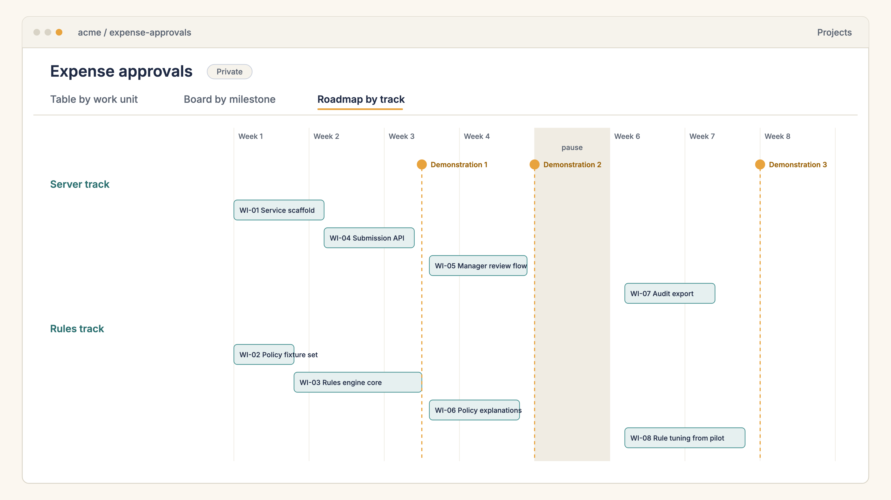
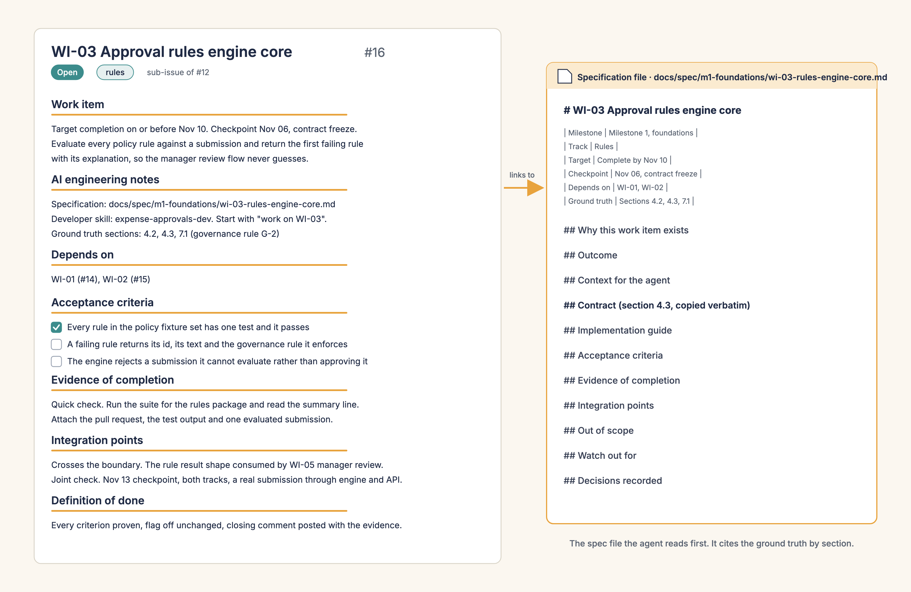

# Sample output

This page shows what carrydown produced for a fictional project, an internal expense approvals service. The people, the company and the numbers are made up. Nothing here needs an install.

## Live links

- The repository: https://github.com/sct-will/carrydown-sample
- The issues the scripts created: https://github.com/sct-will/carrydown-sample/issues (the Epic is issue 1, the five sub-epics are issues 2 to 6, the nine work items are issues 7 to 15)
- The project board: https://github.com/users/sct-will/projects/2
- The plan, below: [Plan](#plan)

## The dry run

Before anything was written to GitHub, the dry run printed this summary line. It is the line to read before you say "Go ahead."

```text
1 Epic, 5 sub-epics, 9 work item issues
```

After the write, the verification step checked the counts through GitHub.

| Thing | Count |
| --- | --- |
| Labels | 4 |
| Epic | 1 (issue 1) |
| Sub-epics | 5 (issues 2 to 6) |
| Work item issues | 9 (issues 7 to 15) |
| Sub-issue links | 14 (5 sub-epics under the Epic, 9 work items under their sub-epics) |
| Board items | 15 |
| Board fields filled | Work unit on 14, Track on 9, Complete by on 14, Checkpoint on 14 |
| Board views | Table, Board, Roadmap |
| Work unit iterations | 5, with the pause week left as a break |

## Plan

The checker's report on the sample plan: the schedule, the load table, the critical path, the program items and the checkpoints. The checker found 15 files clean and 0 findings.

```text
Plan: Expense approvals

Schedule
  Work unit 1, Submit an expense report: 2027-02-01 to 2027-02-12 (demonstration 2027-02-12)
  Work unit 2, Route to approvers: 2027-02-15 to 2027-03-05 (demonstration 2027-03-05)
  Work unit 3, Enforce policy: 2027-03-08 to 2027-03-19 (demonstration 2027-03-19)
  Work unit 4, Pilot with one team: 2027-03-29 to 2027-04-09 (demonstration 2027-04-09)
  Work unit 5, Release: 2027-04-12 to 2027-04-23 (demonstration 2027-04-23)
  Break, Offsite and planning week: 2027-03-22 to 2027-03-26

Load (items per person per work unit, with sized days where the size says 'about N days')
  Person  WU1     WU2     WU3     WU4     WU5     Total  
  tamsin  1 (3d)  1 (5d)  2 (6d)  1 (4d)  0       5 (18d)
  idris   1 (4d)  1 (4d)  1 (4d)  0       1 (3d)  4 (15d)

Critical path (longest dependency chain to the last item)
  WI-02 -> WI-04 -> WI-08 -> WI-11  (79 calendar days)
    WI-02 Report form and receipt upload, by 2027-02-10, idris
    WI-04 Approver inbox and decisions, by 2027-03-03, idris
    WI-08 Notifications and delegates, by 2027-03-18, idris
    WI-11 Release readiness and runbook, by 2027-04-21, idris

Program-owned items (outside the development plan; referenced only as program input)
  WI-05 Pilot team recruitment
  WI-10 Finance sign-off

Checkpoints
  2027-02-05  Contract freeze: WI-01
  2027-02-12  Milestone 1 demonstration: WI-02
  2027-02-26  Routing meets inbox: WI-03
  2027-03-05  Milestone 2 demonstration: WI-04
  2027-03-12  Rules meet routing: WI-06
  2027-03-19  Milestone 3 demonstration: WI-07, WI-08
  2027-04-09  Pilot readout: WI-09
  2027-04-23  Release: WI-11
```

## What it looks like

These are renderings of the sample output, not screenshots. The item names in the pictures differ slightly from the live sample, which is linked above.


A rendering of the sample output: the table view, grouped by work unit, with track, dates and parent.



A rendering of the sample output: the roadmap view, with work units of different lengths and the pause week.



A rendering of the sample output: one work item issue and the specification file it links to.

## The files

All paths are in this repository under `sample/expense-approvals/`.

- The source document: [ground-truth/architecture.md](../sample/expense-approvals/ground-truth/architecture.md)
- Its rendering with a section index: [docs/ground-truth/architecture.md](../sample/expense-approvals/docs/ground-truth/architecture.md)
- The inputs: [people.yaml](../sample/expense-approvals/people.yaml) and [timeline.yaml](../sample/expense-approvals/timeline.yaml)
- The plan as data: [docs/spec/plan.yaml](../sample/expense-approvals/docs/spec/plan.yaml)
- The conventions, schedule and index: [docs/spec/README.md](../sample/expense-approvals/docs/spec/README.md)
- The milestone files and one specification per work item:

- [Milestone 1, Submit an expense report](../sample/expense-approvals/docs/spec/m1-submit-report/milestone.md)
  - [WI-01 Service scaffold, flag and API contract](../sample/expense-approvals/docs/spec/m1-submit-report/wi-01-service-scaffold.md)
  - [WI-02 Report form and receipt upload](../sample/expense-approvals/docs/spec/m1-submit-report/wi-02-report-form.md)
- [Milestone 2, Route to approvers](../sample/expense-approvals/docs/spec/m2-route-to-approvers/milestone.md)
  - [WI-03 Approval routing engine](../sample/expense-approvals/docs/spec/m2-route-to-approvers/wi-03-routing-engine.md)
  - [WI-04 Approver inbox and decisions](../sample/expense-approvals/docs/spec/m2-route-to-approvers/wi-04-approver-inbox.md)
- [Milestone 3, Enforce policy](../sample/expense-approvals/docs/spec/m3-enforce-policy/milestone.md)
  - [WI-06 Approval limits and separation of duties](../sample/expense-approvals/docs/spec/m3-enforce-policy/wi-06-limits-and-duties.md)
  - [WI-07 Audit log and retention](../sample/expense-approvals/docs/spec/m3-enforce-policy/wi-07-audit-log.md)
  - [WI-08 Notifications and delegates](../sample/expense-approvals/docs/spec/m3-enforce-policy/wi-08-notifications-delegates.md)
- [Milestone 4, Pilot with one team](../sample/expense-approvals/docs/spec/m4-pilot/milestone.md)
  - [WI-09 Ledger export job](../sample/expense-approvals/docs/spec/m4-pilot/wi-09-ledger-export.md)
- [Milestone 5, Release](../sample/expense-approvals/docs/spec/m5-release/milestone.md)
  - [WI-11 Release readiness and runbook](../sample/expense-approvals/docs/spec/m5-release/wi-11-release-readiness.md)

- The generated developer skill: [docs/dev/skills/expense-approvals-dev](../sample/expense-approvals/docs/dev/skills/expense-approvals-dev/SKILL.md)

## How it was made

From the root of the kit repository, with a throwaway token stored by `github_token.py`:

```bash
python3 scripts/render_ground_truth.py sample/expense-approvals/ground-truth/architecture.md --root sample/expense-approvals --version 0.3
python3 scripts/check_specs.py --root sample/expense-approvals --report
python3 scripts/github_sync.py --root sample/expense-approvals --repo sct-will/carrydown-sample --create-epic --apply
python3 scripts/github_project.py --root sample/expense-approvals --repo sct-will/carrydown-sample --apply
```

[docs/sample-run.md](sample-run.md) records the console output of a full run, including the dry runs.
